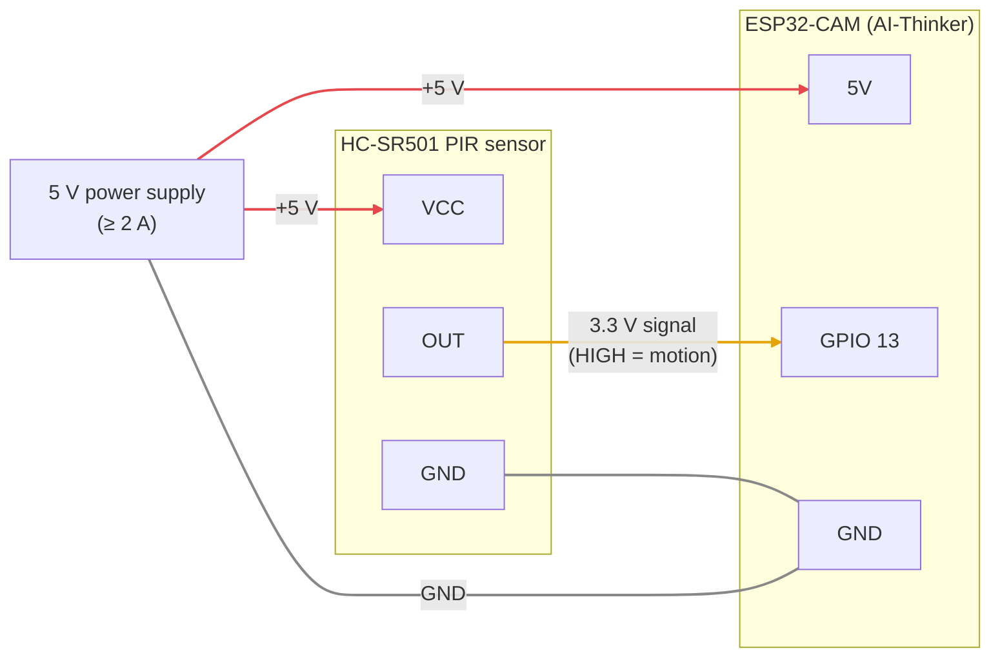

# ESP32-CAM Multi-Camera System

A complete multi-camera streaming and image capture system for ESP32-CAM modules with a modern web interface.

## Features

### ESP32 Features
- ✅ **Continuous MJPEG streaming** at QVGA (320x240)
- ✅ **Periodic high-quality captures** at UXGA (1600x1200)
- ✅ **Non-blocking uploads** using FreeRTOS tasks
- ✅ **Minimal stream interruption** (~300ms during HQ capture)
- ✅ **Self-recovery**: reconnects WiFi and restarts itself after prolonged WiFi, upload or capture failures, plus a watchdog for hung uploads
- ✅ **Optional motion sensor** (PIR / radar): uploads frames as fast as possible while motion is detected; the hub mails the first image and turns the frames into a motion clip
- ✅ **Diagnostics** (signal strength, free memory, uptime, restart reason) sent with every upload and logged by the server

### Web Interface Features
- ✅ **Multi-camera grid view** (desktop) or list view (mobile)
- ✅ **Live MJPEG streams** for each camera
- ✅ **Fullscreen mode** with stream/image toggle
- ✅ **Interactive timeline** to browse captured images
- ✅ **Responsive design** for mobile and desktop
- ✅ **Real-time statistics** and camera status

### Server Features
- ✅ **Automatic camera detection** by IP address
- ✅ **Per-camera folder organization** (e.g., uploads/129/)
- ✅ **Auto-cleanup** (keeps last 100 images per camera)
- ✅ **RESTful API** for integration
- ✅ **Web dashboard** and status monitoring

## Quick Start

### 1. Start the Python Server

```bash
# Install dependencies
pip install -r requirements.txt

# Run the server
python3 image_server.py
```

Or use the convenience script:
```bash
chmod +x start_server.sh
./start_server.sh
```

### 2. Configure ESP32-CAM

Update the WiFi credentials in `esp-cam4.ino`:
```cpp
const char* ssid = "your-wifi-name";
const char* password = "your-wifi-password";
const char* serverUrl = "http://192.168.2.38:5000/upload";
```

### Optional: Motion Sensor
The sensor is optional: cameras without one work as before and show no motion information.
Camera-based motion detection suffers from sensor noise and lighting changes, so a dedicated
sensor is used instead. Any sensor with a digital output that goes HIGH on motion works,
e.g. an **HC-SR501 PIR** or **RCWL-0516 radar** module:



| Sensor | ESP32-CAM (AI-Thinker) |
|--------|------------------------|
| VCC    | 5V |
| GND    | GND next to 5V (the same GND as the power supply) |
| OUT    | GPIO 13 |

> **Use the GND pin next to 5V.** Not every header pin labelled GND is connected to ground on
> all ESP32-CAM boards. With the sensor on such a pin its output never goes LOW, so every image
> is flagged as motion. If in doubt, check with a multimeter that the pin has continuity with
> the power supply's ground.

The sensor's output is 3.3 V, so it connects directly to the GPIO without a level shifter.
Then enable it for that camera, either in `esp-cam4.ino` or in its `credentials.h`:

```cpp
#define MOTION_PIN 13   // -1 (default) = no sensor
```

- While motion is detected the camera uploads frames as fast as it can (a few per second instead
  of one every 10 s); these images are saved as `HH-MM-SS-mmm_m.jpg`, highlighted red in the
  timeline, marked on the scrubber and get a red timestamp in the daily video, where they play at
  the same timelapse speed as all other images
- The first image of a motion event is mailed to you (see [Motion mails](#optional-motion-mails))
- Once the event has ended (a normal image follows, or no new frame for 20 s), the hub encodes its
  frames into a real-time clip in `clips/<date>/`. The event's first image in the timeline gets a
  ▶ badge and a **Clip abspielen** button (or press **P**); the video view of a day lists its clips.
  Clips are kept when the day's images are deleted after the daily video is built
- Cameras with a sensor show a motion badge in the grid (pulsing red while motion is detected,
  otherwise today's number of motion events), and the calendar shows the number of motion
  events per day. A motion event is a run of consecutive motion images
- The PIR needs about a minute to settle after power-up; triggers during that time are ignored
- HC-SR501: set the jumper to repeat trigger (H) and turn the time-delay pot to its minimum.
  If it triggers falsely, move it a few cm away from the ESP32's antenna (WiFi interference)

### Optional: Motion Mails
The hub mails the first image of each motion event. Copy `.env.example` to `.env` next to
`docker-compose.yml` and fill in your SMTP server and the recipients, then restart the container
(`docker compose up -d`). Without `SMTP_HOST` and `MAIL_TO`, no mails are sent.

| Variable | Meaning |
|----------|---------|
| `SMTP_HOST`, `SMTP_PORT` | SMTP server, e.g. port 587 with STARTTLS or 465 with SSL |
| `SMTP_SECURITY` | `starttls` (default), `ssl` or `none` |
| `SMTP_USER`, `SMTP_PASSWORD` | Login; leave the user empty for servers without authentication |
| `MAIL_FROM` | Sender address, defaults to `SMTP_USER` |
| `MAIL_TO` | Recipients, comma-separated |
| `MAIL_COOLDOWN_MINUTES` | At most one mail per camera within this time (default 5) |
| `HUB_URL` | Hub address for the timeline link in the mail, e.g. `http://192.168.2.38:5000` |

`env_file` with `required: false` needs Docker Compose 2.24 or newer.

### 3. Upload to ESP32

1. Open `esp-cam4.ino` in Arduino IDE
2. Select board: "AI Thinker ESP32-CAM"
3. Upload the sketch
4. Open Serial Monitor (115200 baud) to see the camera's IP address

### 4. Access the Web Interface

Open in your browser:
```
http://192.168.2.38:5000
```

## Web Interface Usage

### Main Grid View
- Shows all connected cameras as live streams
- Click any stream to open fullscreen view
- Displays camera IP and image count

### Fullscreen View
- **Live Stream**: Watch the MJPEG stream in real-time
- **Captured Images**: View high-quality captured images
- **Timeline**: Scroll through all captured images at the bottom
- Click any thumbnail to display that image
- **← / →**: previous / next image
- **M / Shift+M**: jump to the next / previous motion event (cameras with a motion sensor)
- **P**: play / close the motion clip of the selected event
- Press **ESC** or click **×** to close

## File Structure

```
ESP/
├── esp-cam4.ino           # ESP32-CAM firmware
├── image_server.py        # Python Flask server
├── requirements.txt       # Python dependencies
├── start_server.sh        # Server startup script
├── static/
│   ├── index.html        # Web interface
│   ├── style.css         # Styling
│   └── script.js         # Frontend logic
└── uploads/
    ├── 127/              # Camera at 192.168.2.127
    ├── 128/              # Camera at 192.168.2.128
    └── 129/              # Camera at 192.168.2.129
```

## API Endpoints

### Upload
- `POST /upload` - Receive images from ESP32

### Images
- `GET /latest` - Latest image from any camera
- `GET /latest/<camera_id>` - Latest from specific camera
- `GET /uploads/<camera_id>/<filename>` - Specific image file
- `GET /clip/<camera_id>/<date>/<name>` - Motion clip (MP4)

### Stats & Lists
- `GET /stats` - Statistics per camera (JSON)
- `GET /images` - All images from all cameras (JSON)
- `GET /images/<camera_id>` - Images from specific camera (JSON)

### Frontend
- `GET /` - Multi-camera web interface
- `GET /dashboard` - Status dashboard (legacy)

## Configuration

### Python Server (`image_server.py`)
```python
UPLOAD_FOLDER = 'uploads'          # Where images are stored
KEEP_LAST_N_IMAGES = 100          # Images to keep per camera
```

### ESP32 (`esp-cam4.ino`)
```cpp
const unsigned long UPLOAD_INTERVAL_MS = 10000;  // Upload every 10 seconds
const framesize_t CAMERA_FRAMESIZE = FRAMESIZE_XGA;
const int CAMERA_QUALITY = 12;                   // Lower = better quality
#define MOTION_PIN -1                            // GPIO of the optional motion sensor
const unsigned long MOTION_FRAME_INTERVAL_MS = 250;  // Minimum upload gap while motion is detected
```

### Frontend (`static/script.js`)
```javascript
const REFRESH_INTERVAL = 10000;    // Refresh cameras every 10s
const NETWORK_PREFIX = '192.168.2.'; // Your network prefix
```

## Troubleshooting

### Camera Not Appearing
1. Check ESP32 Serial Monitor for IP address
2. Verify camera can reach the server (ping test)
3. Check firewall settings on server

### Stream Not Loading
1. Ensure ESP32 is on the same network
2. Try accessing stream directly: `http://192.168.2.129/stream`
3. Check browser console for CORS errors

### Upload Failures
1. Verify `serverUrl` in ESP32 code matches server IP
2. Check server logs for error messages
3. Ensure sufficient PSRAM on ESP32

### Camera Losing Connection
The firmware recovers on its own: it retries WiFi every 30 s, restarts after 5 minutes
without WiFi, after ~5 minutes of failed uploads or after 10 failed captures. Every upload
logs diagnostics on the server (`docker logs esp-cam`):

```
✓ Camera 129: 2026-10-14/09-53-15.jpg (48211 bytes) rssi=-71 free-heap=91234 min-free-heap=80000 uptime=3600 reset-reason=poweron
⚠ Camera 129 restarted, reason: brownout
```

- `reset-reason=brownout`: voltage dips → use a stronger 5 V supply (≥ 2 A) and a short, thick cable
- `reset-reason=software:wifi_lost` / `rssi` below about -75 dBm: weak signal → move the camera or router, or use an external antenna
- `reset-reason=panic` / `task_watchdog` or `min-free-heap` shrinking over time: firmware crash or memory leak
- `reset-reason=software:upload_failed`: camera had WiFi but couldn't reach the server

### Image Quality Issues
- For better quality: Lower `jpeg_quality` value (e.g., 8)
- For faster capture: Use lower resolution (SVGA instead of UXGA)
- Adjust `xclk_freq_hz` (10MHz is stable, 20MHz is faster)

## Network Configuration

If your network uses a different subnet, update `script.js`:
```javascript
const NETWORK_PREFIX = '192.168.1.'; // Change to your subnet
```

## Performance Tips

1. **Reduce upload interval** for more frequent captures:
   ```cpp
   const int uploadInterval = 30000; // 30 seconds
   ```

2. **Increase retention** to keep more images:
   ```python
   KEEP_LAST_N_IMAGES = 500
   ```

3. **Lower capture quality** for faster uploads:
   ```cpp
   s->set_quality(s, 12); // Higher number = lower quality
   ```

## License

This project is provided as-is for educational and personal use.

## Credits

Built with:
- ESP32-CAM / Arduino
- Flask (Python)
- Vanilla JavaScript
- FreeRTOS


<!-- 192.168.2.202/stream:1  GET http://192.168.2.202/stream net::ERR_INCOMPLETE_CHUNKED_ENCODING 200 (OK) -->